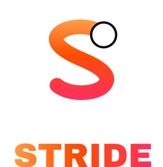

# STRIDE

A full-featured, Strava-style fitness tracking app — running, cycling and training — built as an installable PWA. Record GPS activities, explore segments and routes, join clubs and challenges, follow athletes, give kudos, and watch your fitness evolve.



## Highlights

- **Activity recording** — GPS track capture with live stats (pace, speed, heart rate, elevation), auto splits, segment matching and a slide-to-save flow. A background-recording state keeps a live session alive while you browse.
- **Feed & social** — activity cards with map previews, kudos, comments, posts with photos, follows, and a notifications inbox with unread badges.
- **Maps & exploration** — MapLibre-based heatmaps, nearby segments with local legends and matched efforts, saved routes, and a full tap-to-build route builder with turn-by-turn cues.
- **Training load & fitness** — rolling fitness/fatigue/form charts, weekly distance, elevation, time-in-heart-rate-zone, training log with weekly summaries, personal records, and trophies.
- **Clubs & challenges** — club feeds with events, club-organizer tools, progress-based challenges (individual, group, private).
- **Gear, profile & settings** — gear mileage tracking, detailed athlete profiles, privacy controls, appearance (light/dark, synced per-account), premium subscription gate with a full paywall flow.
- **PWA** — installable, offline-friendly shell, splash screens, maskable icon, custom brand identity.

## Tech stack

- **Next.js 16** (App Router) + React 19 + TypeScript
- **Tailwind CSS 4** + shadcn/ui-style components, **framer-motion** animations
- **Prisma ORM** on **SQLite**
- **MapLibre GL** maps, **TanStack Query** data layer, **Zustand** state
- Runtime: **Bun** (or Node 20+)

## Getting started

Prerequisites: [Bun](https://bun.sh) (or Node 20+) and Git.

```bash
# 1. install dependencies
bun install

# 2. create the database file + Prisma client
echo 'DATABASE_URL=file:./db/custom.db' > .env
mkdir -p db
bun run db:push

# 3. seed a realistic demo dataset (athletes, GPS activities on real
#    Dhaka/Berlin/London/Sydney streets, segments, clubs, challenges)
bun run db:seed

# 4. start the dev server
bun run dev
```

Open http://localhost:3000 and sign in with the demo athlete:

| Email | Password |
|---|---|
| `alex@striden.app` | `stridedemo` |

(The seed creates 16 athletes — `nusrat@striden.app`, `tanvir@striden.app`, … all use the same password.)

## Scripts

| Command | What it does |
|---|---|
| `bun run dev` | Dev server on port 3000 |
| `bun run build` / `bun run start` | Production build (standalone output) & serve |
| `bun run lint` | ESLint |
| `bun run db:push` | Create/patch SQLite schema from `prisma/schema.prisma` |
| `bun run db:seed` | Regenerate the demo dataset |
| `bun scripts/brand.py` | Regenerate brand assets (logo, icons, splash art) |

## Project layout

```
src/
  app/            App Router entry, global styles, PWA manifest
  components/app/ Shell + tab bar, cards, charts, map view, brand, UI kit
  screens/        30 feature screens (feed, recording, maps, clubs, …)
  server/         API handlers, auth, seed support
  lib/            nav/recorder/geo/sports/api utilities
  hooks/          React hooks (queries, recorder)
prisma/           Database schema
scripts/          Seed, brand asset generator
public/           Icons, brand art, map styles
```

## Notes

- Stride is a portfolio/educational clone of the Strava experience and is not affiliated with Strava Inc.
- Map data © OpenStreetMap contributors; route geometries in the seed are fetched via OSRM.
